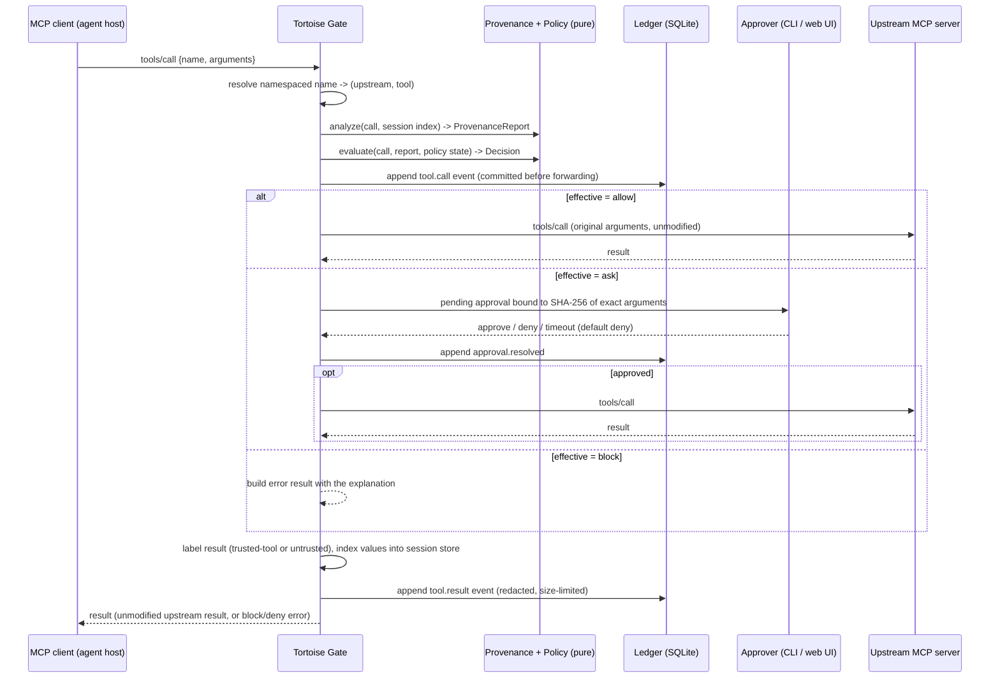
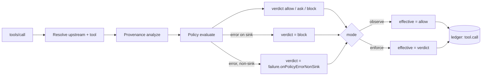
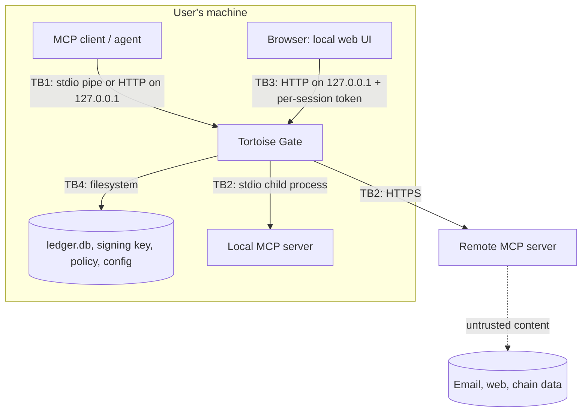

# Architecture

Tortoise Gate is a local process that sits between an MCP client (the agent host, such as Claude Code) and the MCP servers that provide its tools. To the client it is an MCP server. To each upstream it is an MCP client. Every `tools/call` passes through a deterministic decision pipeline before it reaches an upstream.

## Pinned versions (verified 2026-10-29)

| Item               | Version                                                                                                        | How verified                                                                                                 |
| ------------------ | -------------------------------------------------------------------------------------------------------------- | ------------------------------------------------------------------------------------------------------------ |
| Node.js            | 24.22.0 (24 LTS line)                                                                                          | `node -v`                                                                                                    |
| pnpm               | 12.15.0                                                                                                        | `pnpm -v`; `packageManager` in `package.json`                                                                |
| TypeScript         | 6.0.3                                                                                                          | typescript-eslint 8.72.1 requires `>=4.8.4 <6.1.0`, so 7.x is not used yet                                   |
| zod                | 4.6.7                                                                                                          | `npm view zod version`                                                                                       |
| MCP specification  | **2026-07-28** (latest), **2025-11-25** (previous)                                                             | `modelcontextprotocol/modelcontextprotocol` repo `schema/` and `docs/specification/2026-07-28/changelog.mdx` |
| MCP TypeScript SDK | `@modelcontextprotocol/server` 2.4.0, `@modelcontextprotocol/client` 2.4.0, `@modelcontextprotocol/node` 2.1.2 | npm registry; server README states v2 is the stable line implementing 2026-07-28                             |
| Legacy SDK         | `@modelcontextprotocol/sdk` 1.32.2 (v1 line, `LATEST_PROTOCOL_VERSION = "2025-11-25"`)                         | package `dist/esm/types.d.ts`                                                                                |

See [ADR 0008](adr/0008-mcp-sdk-v2-and-protocol-versions.md) for why we use SDK v2.

### Protocol revisions the gateway must handle

The two revisions differ in ways that matter to a proxy:

- **2025-11-25 (stateful).** It has an `initialize` / `notifications/initialized` handshake. Streamable HTTP uses `Mcp-Session-Id`, an optional GET stream, and SSE resumability. Servers can send requests such as sampling and elicitation.
- **2026-07-28 (stateless).** There is no handshake. Each request carries protocol version and client capabilities in `_meta`. `server/discover` advertises versions. `subscriptions/listen` replaces the GET stream and `resources/subscribe`. Multi Round-Trip Requests (`resultType: "input_required"`) replace server-initiated sampling, elicitation and roots requests. Every result carries `resultType`. There are no session IDs and no SSE resumability.

Most deployed clients and servers in October 2026 are expected to speak 2025-11-25. Phase 1 must confirm with tests which revisions the SDK v2 client and server negotiate, and how. Until then, treat this as **unverified**.

## Components

| Package      | Role                                                                                                                       | Phase   |
| ------------ | -------------------------------------------------------------------------------------------------------------------------- | ------- |
| `core`       | Shared types and zod schemas: events, decisions, trust labels, provenance reports, config, versioning                      | 0       |
| `gateway`    | MCP proxy (client-facing server + upstream clients), tool namespacing, decision pipeline, approval queue, local web server | 1, 5, 6 |
| `ledger`     | Append-only SQLite store, hash chain, signed checkpoints, redaction, export, verifier                                      | 2       |
| `provenance` | Source recording, value extraction and normalisation, matching, near-match and address-poisoning detection                 | 3       |
| `policy`     | YAML policy DSL, evaluator, persistent state (first-seen, windows), explanations, templates                                | 4       |
| `graph`      | Data-flow graph built from the ledger, local SQLite store, TigerGraph adapter, causal-path queries                         | 8       |
| `cli`        | `tortoisegate` binary: `wrap`, `ledger verify`, `approvals`, ...                                                           | 1+      |

## Data flow for one tool call

### Decision pipeline (deterministic core)

Rules for the pipeline:

- **Purity.** `analyze` and `evaluate` take all their inputs as arguments. They make no network calls and no LLM calls, and read no clock. The caller passes the current time in, so the same input always gives the same `Decision`.
- **Write-ahead logging.** The `tool.call` event is committed to the ledger before the call is forwarded. If the ledger cannot commit, the call is blocked; this does not depend on mode, because an action that cannot be recorded must not happen. The latency budget accounts for this commit.
- **Forwarding is byte-faithful.** The gateway forwards the client's original arguments and the upstream's original result. Redaction applies only to what is stored.
- **Blocked and denied calls** return a `CallToolResult` with `isError: true` and a text explanation, so the model sees why. Phase 1 confirms this is the correct shape for both protocol revisions.

### Tool namespacing

- With a single upstream (`tortoisegate wrap -- <cmd>`), tool names are passed through unchanged, so existing client configs and prompts keep working.
- With more than one upstream, every tool is exposed as `<serverId>__<tool>`. Prefixing always, not only on collision, stops a malicious server from shadowing a trusted server's tool name. `serverId` is a config slug (`^[a-z0-9][a-z0-9-]{0,62}$`).

### Protocol feature scope (deadline build)

| Feature                                                                                          | Status                                                                                                                                                     |
| ------------------------------------------------------------------------------------------------ | ---------------------------------------------------------------------------------------------------------------------------------------------------------- |
| tools (`list`, `call`, list-changed)                                                             | Inspected and enforced                                                                                                                                     |
| resources, prompts                                                                               | Forwarded. Contents are recorded as `untrusted` sources (resources and prompts are content the agent reads)                                                |
| sampling, elicitation, roots (server-to-client requests, or MRTR `input_required` in 2026-07-28) | **Unsupported.** Not advertised in the gateway's capabilities. If an upstream sends one, the gateway returns an explicit error and logs it, never silently |
| completion, logging, progress, cancellation                                                      | Forwarded unchanged; not inspected                                                                                                                         |
| tasks extension                                                                                  | Unsupported; not advertised                                                                                                                                |

## Trust boundaries

- **TB1, client to gateway.** The client is the user's agent. Its requests are what we inspect. The agent itself may be compromised by injected content.
- **TB2, gateway to upstream.** Upstream output is untrusted unless the user marks a tool as trusted. Server metadata (names, descriptions, annotations such as `readOnlyHint`) is also untrusted. Annotations may make policy stricter but never looser.
- **TB3, browser to local web UI.** Binds to `127.0.0.1` only (not configurable). It uses a random per-session token, requires the `Host` header to be loopback, and sets no CORS headers. State-changing requests need the token in a header, never in a cookie alone. This defeats DNS rebinding and CSRF.
- **TB4, filesystem.** The ledger DB, signing key and policy live under the user's data directory with `0600` / `0700` permissions. Local malware running as the same user is out of scope (see the threat model).

## Persistent state

- `ledger.db` (SQLite WAL): events, chain hashes, checkpoints. This is the source of truth.
- Policy state (first-seen values, spend and rate windows): a separate table in the same DB, rebuildable from ledger history.
- Session provenance index: in memory, bounded, per session. It can be rebuilt from `tool.result` events.
- Graph: derived from the ledger, so it can always be rebuilt.

## Performance budget

- Policy-only added latency: under 10 ms median and under 50 ms p99 per tool call on a typical laptop. This is measured locally and recorded in `docs/performance.md`.
- CI gates on **relative** overhead (gateway against direct), because shared runners are noisy. The benchmark job is added in Phase 1.
