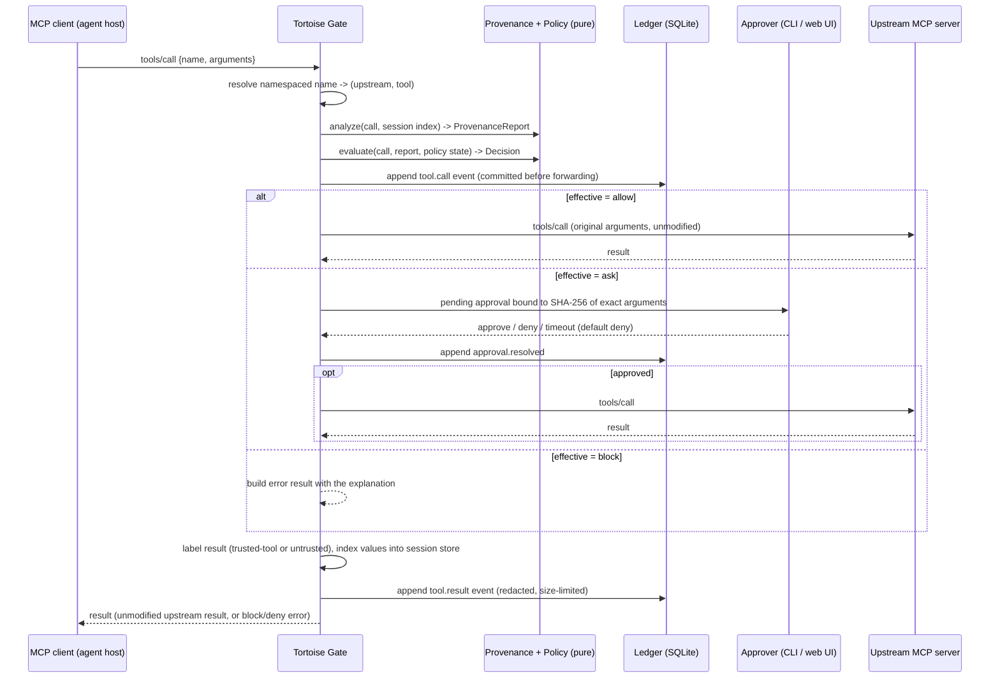
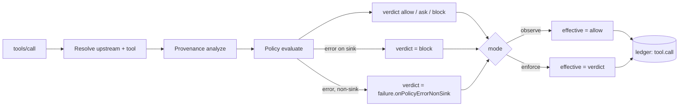
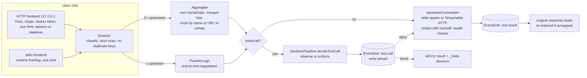
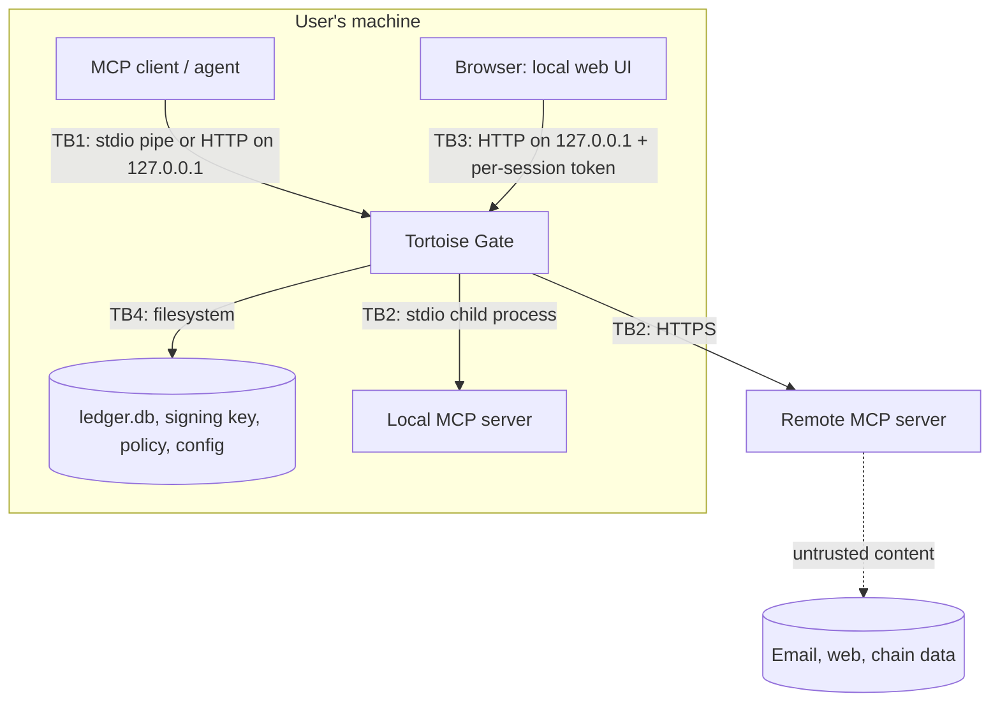

# Architecture

Tortoise Gate is a local process that sits between an MCP client (the agent host, such as Claude Code) and the MCP servers that provide its tools. To the client it is an MCP server. To each upstream it is an MCP client. Every `tools/call` passes through a deterministic decision pipeline before it reaches an upstream.

## Pinned versions (verified 2026-10-29)

| Item               | Version                                                                                                        | How verified                                                                                                 |
| ------------------ | -------------------------------------------------------------------------------------------------------------- | ------------------------------------------------------------------------------------------------------------ |
| Node.js            | 24.22.0 (24 LTS line)                                                                                          | `node -v`                                                                                                    |
| pnpm               | 12.15.0                                                                                                        | `pnpm -v`; `packageManager` in `package.json`                                                                |
| TypeScript         | 6.0.3                                                                                                          | typescript-eslint 8.72.1 requires `>=4.8.4 <6.1.0`, so 7.x is not used yet                                   |
| zod                | 4.6.7                                                                                                          | `npm view zod version`                                                                                       |
| MCP specification  | **2026-07-28** (latest), **2025-11-25** (previous)                                                             | `modelcontextprotocol/modelcontextprotocol` repo `schema/` and `docs/specification/2026-07-28/changelog.mdx` |
| MCP TypeScript SDK | `@modelcontextprotocol/server` 2.4.0, `@modelcontextprotocol/client` 2.4.0, `@modelcontextprotocol/node` 2.1.2 | npm registry; server README states v2 is the stable line implementing 2026-07-28                             |
| Legacy SDK         | `@modelcontextprotocol/sdk` 1.32.2 (v1 line, `LATEST_PROTOCOL_VERSION = "2025-11-25"`)                         | package `dist/esm/types.d.ts`                                                                                |

See [ADR 0008](adr/0008-mcp-sdk-v2-and-protocol-versions.md) for why we use SDK v2.

### Protocol revisions the gateway must handle

The two revisions differ in ways that matter to a proxy:

- **2025-11-25 (stateful).** It has an `initialize` / `notifications/initialized` handshake. Streamable HTTP uses `Mcp-Session-Id`, an optional GET stream, and SSE resumability. Servers can send requests such as sampling and elicitation.
- **2026-07-28 (stateless).** There is no handshake. Each request carries protocol version and client capabilities in `_meta`. `server/discover` advertises versions. `subscriptions/listen` replaces the GET stream and `resources/subscribe`. Multi Round-Trip Requests (`resultType: "input_required"`) replace server-initiated sampling, elicitation and roots requests. Every result carries `resultType`. There are no session IDs and no SSE resumability.

Verified in Phase 1 (details in [ADR 0008](adr/0008-mcp-sdk-v2-and-protocol-versions.md) and [compatibility](compatibility.md)):

- The reference servers are dual-era. They answer `initialize` with 2025-11-25, and they answer 2026-07-28 requests that carry the `_meta` envelope.
- The v2 SDK client uses 2025-11-25 by default, and 2026-07-28 when pinned. The v1 SDK client uses 2025-11-25.
- Claude Code 2.1.312 uses 2026-07-28.

The gateway handles each revision independently on each side: a 2026-07-28 client can use a 2025-11-25 upstream and the reverse.

## Components

| Package      | Role                                                                                                                       | Phase   |
| ------------ | -------------------------------------------------------------------------------------------------------------------------- | ------- |
| `core`       | Shared types and zod schemas: events, decisions, trust labels, provenance reports, config, versioning                      | 0       |
| `gateway`    | MCP proxy (client-facing server + upstream clients), tool namespacing, decision pipeline, approval queue, local web server | 1, 5, 6 |
| `ledger`     | Append-only SQLite store, hash chain, signed checkpoints, redaction, export, verifier                                      | 2       |
| `provenance` | Source recording, value extraction and normalisation, matching, near-match and address-poisoning detection                 | 3       |
| `policy`     | YAML policy DSL, evaluator, persistent state (first-seen, windows), explanations, templates                                | 4       |
| `graph`      | Data-flow graph built from the ledger, local SQLite store, TigerGraph adapter, causal-path queries                         | 8       |
| `cli`        | `tortoisegate` binary: `wrap`, `serve` (Phase 1); `ledger ...`, `approvals` later                                          | 1+      |

## Data flow for one tool call

### Decision pipeline (deterministic core)

Rules for the pipeline:

- **Purity.** `analyze` and `evaluate` take all their inputs as arguments. They make no network calls and no LLM calls, and read no clock. The caller passes the current time in, so the same input always gives the same `Decision`.
- **Write-ahead logging.** The `tool.call` event is committed to the event sink before the call is forwarded. If it cannot be written: in `enforce` mode the call is blocked with `TG_LEDGER_UNAVAILABLE`; in `observe` mode the call is allowed and the gateway logs a loud error (observe never changes behaviour). This was the user's Phase 1/2 decision and replaces the Phase 0 "block in every mode" rule. The latency budget accounts for this write.
- **Forwarding is byte-faithful.** The gateway relays raw JSON-RPC text and never re-serialises it ([ADR 0010](adr/0010-raw-json-rpc-relay.md)). Only single spans are spliced (id, namespaced name, `_meta` envelope, unsupported capabilities). Redaction applies only to what is stored.
- **Blocked and denied calls** return a `CallToolResult` with `isError: true`, a short reason, and `_meta["tortoisegate/decision"]` = `{code, ruleIds, eventId}` ([ADR 0012](adr/0012-blocked-call-result.md)). Verified with the v2 SDK and Claude Code.

### Tool namespacing

See [ADR 0013](adr/0013-tool-namespacing.md). With one upstream, names pass through unchanged. With several, the default `on-collision` scheme prefixes a name as `<serverId>__<tool>` only when more than one upstream offers it. Assignments persist in `names.json`, so known names never change. A bare name shaped like another server's namespace is always prefixed. `always` prefixes everything.

### Protocol feature scope (Phase 1, verified by tests)

| Feature                                                                         | Status                                                                                                                                                                                          |
| ------------------------------------------------------------------------------- | ----------------------------------------------------------------------------------------------------------------------------------------------------------------------------------------------- |
| tools (`list`, `call`, list-changed)                                            | Inspected; enforce applies the deny list                                                                                                                                                        |
| resources, prompts, completion, logging/setLevel                                | Forwarded (aggregate mode routes by URI or name)                                                                                                                                                |
| progress, cancellation                                                          | Forwarded with ids mapped. Over HTTP, progress needs an SSE response (a JSON response cannot carry it)                                                                                          |
| sampling, elicitation, roots (server-to-client requests)                        | **Unsupported.** Removed from the client's capabilities before they reach an upstream. If an upstream still sends one, the gateway answers it with -32601 and logs it; the client never sees it |
| MRTR `resultType: "input_required"` (2026-07-28)                                | **Unsupported.** Converted to a JSON-RPC error for the client and recorded                                                                                                                      |
| tasks (2025 `tasks` capability, 2026 `io.modelcontextprotocol/tasks` extension) | **Unsupported.** Removed from capabilities on both sides                                                                                                                                        |
| JSON-RPC batches                                                                | Rejected with -32600 (neither revision allows them)                                                                                                                                             |
| `subscriptions/listen` (2026-07-28)                                             | Forwarded in passthrough mode; not supported in aggregate mode (-32601)                                                                                                                         |

## Message flow (as built in Phase 1)

- **Upstream lifecycle.** A stdio upstream gets an explicit environment: only `inheritEnv` names (default `DEFAULT_INHERITED_ENV`: PATH, HOME, locale and temp-dir variables) plus its own `env`. `wrap` passes the full environment, because the client launched it with the environment meant for the server. Upstream stderr goes to the gateway log, line by line. A crashed upstream is restarted with exponential backoff (`restartInitialDelayMs` doubling to `restartMaxDelayMs`, at most `restartMaxAttempts` in a row) and then marked down. Calls in flight or sent while it is down get -32001 with a clear message. Health checks use `ping` (2025-11-25) or `server/discover` (2026-07-28) when the link is idle. SIGINT and SIGTERM close the client side, record the session end, close upstream stdin, then SIGTERM and SIGKILL after `shutdownGraceMs`.
- **Limits.** Messages over `limits.maxMessageBytes` (default 16 MiB) are refused with -32002 (HTTP 413 at the frontend). An upstream that sends one is restarted. Requests time out after `limits.requestTimeoutMs` with -32003, and the upstream is sent `notifications/cancelled`.

## Trust boundaries

- **TB1, client to gateway.** The client is the user's agent. Its requests are what we inspect. The agent itself may be compromised by injected content.
- **TB2, gateway to upstream.** Upstream output is untrusted unless the user marks a tool as trusted. Server metadata (names, descriptions, annotations such as `readOnlyHint`) is also untrusted. Annotations may make policy stricter but never looser.
- **TB3, browser to local web UI.** Binds to `127.0.0.1` only (not configurable). It uses a random per-session token, requires the `Host` header to be loopback, and sets no CORS headers. State-changing requests need the token in a header, never in a cookie alone. This defeats DNS rebinding and CSRF.
- **TB4, filesystem.** The ledger DB, signing key and policy live under the user's data directory with `0600` / `0700` permissions. Local malware running as the same user is out of scope (see the threat model).

## Persistent state

- `ledger.db` (SQLite WAL): events, chain hashes, checkpoints. This is the source of truth.
- Policy state (first-seen values, spend and rate windows): a separate table in the same DB, rebuildable from ledger history.
- Session provenance index: in memory, bounded, per session. It can be rebuilt from `tool.result` events.
- Graph: derived from the ledger, so it can always be rebuilt.

## Performance budget

- Policy-only added latency: under 10 ms median and under 50 ms p99 per tool call on a typical laptop. This is measured locally and recorded in `docs/performance.md`.
- CI gates on **relative** overhead: the `latency-benchmark` job measures direct and gateway runs in the same job and fails if the gateway adds more than 2 ms at the median or 20 ms at p99. Local numbers are in [performance](performance.md).
